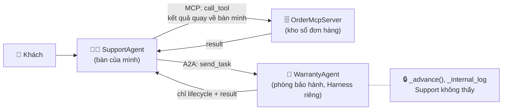
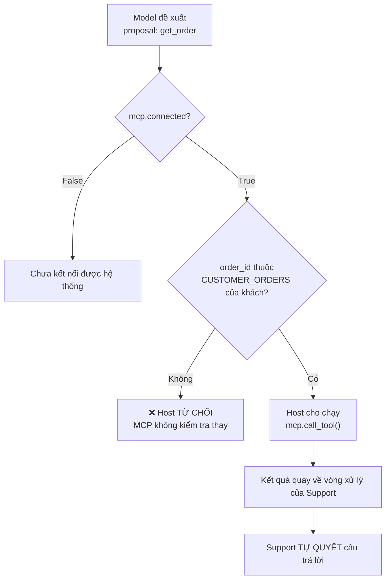
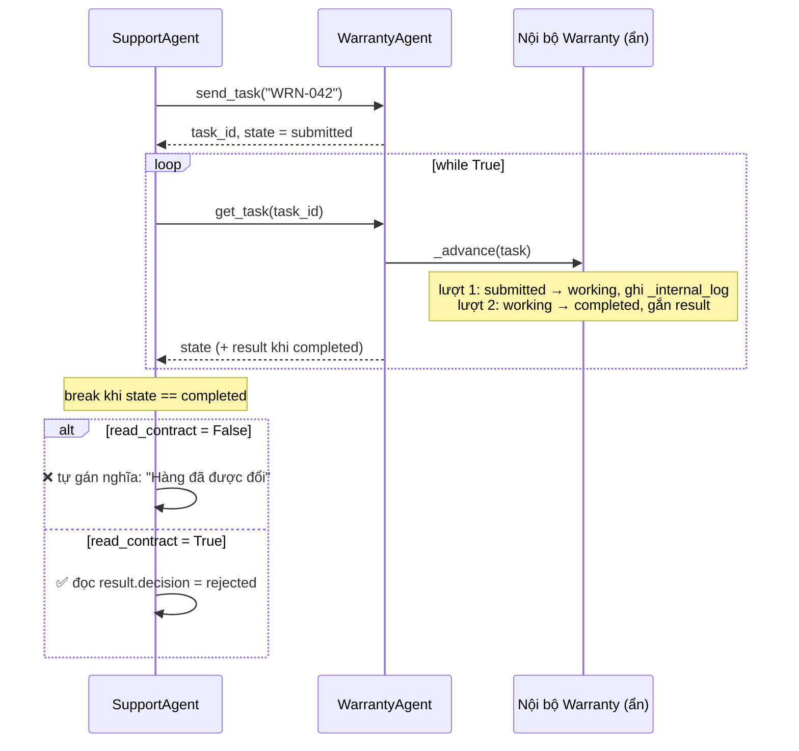
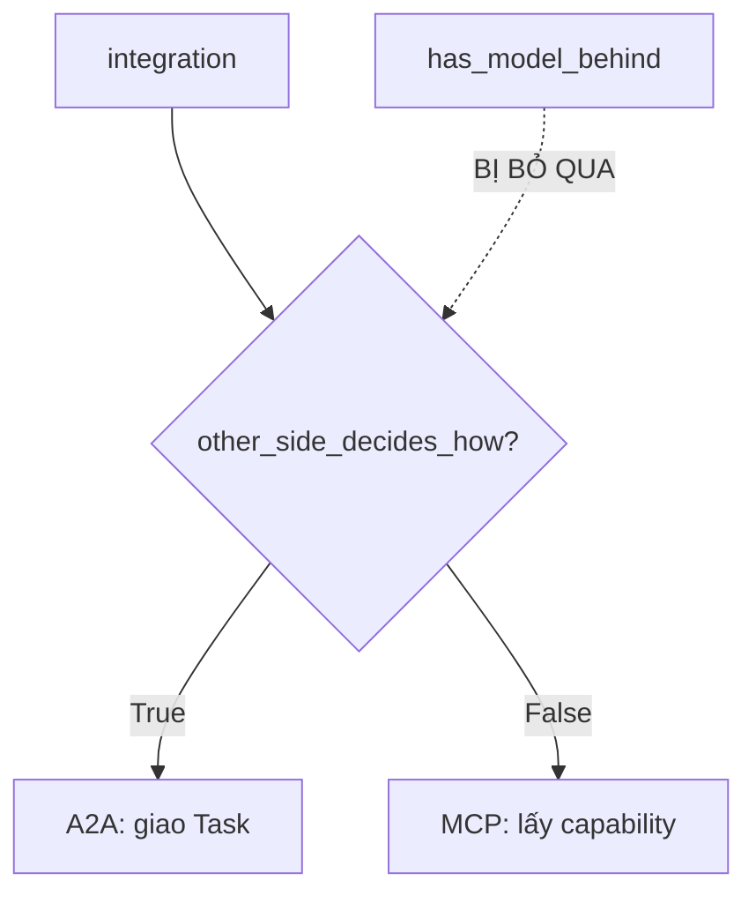

# Bài 09 — MCP và A2A: lấy capability về dùng hay giao việc cho Agent khác

## 1. Ý chính
> **MCP và A2A không phải hai phiên bản của cùng một thứ.** Chúng mô tả **hai kiểu quan hệ** khác nhau, và một hệ thống có thể dùng **cả hai cùng lúc**.

Câu hỏi phân biệt duy nhất: **Việc được làm ở đâu, và bên nào quyết định cách làm?**

| | Việc 1: tra đơn ORD-001 | Việc 2: xét bảo hành WRN-042 |
|---|---|---|
| Ví dụ văn phòng | Ra kho **lấy sổ về bàn mình**, tự đọc, tự quyết | **Chuyển hồ sơ** sang phòng bảo hành, họ tự xét |
| Việc diễn ra ở | Bàn của **mình** | Phòng **bên kia** |
| Ai quyết định cách làm | **Mình** | **Bên kia** |
| Mình thấy gì | Mọi thứ trong sổ | Hồ sơ đang ở đâu + kết quả |
| Protocol | **MCP** | **A2A** |

## 2. Định nghĩa thuật ngữ

| Thuật ngữ | Định nghĩa |
|---|---|
| **MCP** (Model Context Protocol) | Nối **host application** với **server cung cấp capability**. Dùng để lấy capability về dùng trong vòng xử lý của mình |
| **Host application** | Ứng dụng có Agent chạy bên trong. **Kiểm soát việc gọi thật**: có gọi không, có cần hỏi user đồng ý không |
| **MCP server** | Bên **công bố** capability. Phía sau có model hay không cũng không đổi bản chất quan hệ |
| **Capability** | Năng lực server cung cấp: **tools**, **resources**, **prompts** |
| **Tools** | Hành động có thể gọi. **Model có thể đề xuất** gọi |
| **Resources** | Dữ liệu hoặc ngữ cảnh để đọc. Thường do **application hoặc user** chọn đưa vào |
| **Prompts** | Mẫu prompt dựng sẵn cho một kiểu việc |
| **A2A** (Agent2Agent) | Nối **hai Agent system độc lập** để một bên **trao Task** cho bên kia |
| **Agent system độc lập** | Có **Harness riêng**: vòng xử lý, công cụ, quy tắc riêng |
| **Task** | Việc được giao qua A2A, kèm thông tin cần trong lúc xử lý và kết quả |
| **Lifecycle của Task** | Task đang ở giai đoạn nào, **theo cách bên nhận công bố**. **Không phải** bản ghi nội bộ của bên nhận |
| **Contract** | Điều bên phát ra trạng thái cam kết về **ý nghĩa** của trạng thái và kết quả |
| **Connection layer** | Lớp kết nối: xác thực, ủy quyền **giữa hai hệ thống** |
| **Ownership boundary** | Ranh giới: phần nào protocol lo, phần nào **hệ thống bạn vẫn phải tự chịu** |

## 3. So sánh MCP và A2A

| | MCP | A2A |
|---|---|---|
| Hai đầu kết nối | Host (có Agent) ↔ server capability/context | Agent system ↔ Agent system độc lập |
| Trao đổi | Lời gọi tool, đọc resource, prompt | Task, thông tin trao đổi, kết quả |
| Ai điều khiển | Model **đề xuất** tool. **Host kiểm soát** việc gọi thật | Bên giao quyết định **có giao không**. Bên nhận **tự quyết cách làm** |
| Bên gọi thấy gì | Kết quả trả về **vòng xử lý của mình** | **Lifecycle + kết quả**, không thấy bên trong |

**Hai cách hiểu sai:**
- ❌ "A2A là MCP dành cho Agent." Hai protocol trả lời hai câu hỏi khác nhau: *dùng capability* và *giao việc cho bên tự vận hành*.
- ❌ "Phía sau có model thì là A2A." Ranh giới nằm ở **quan hệ**. Một MCP server có model phía sau **vẫn là MCP**.

## 4. "completed" và "đã kết nối" nói được đến đâu
- `completed` có thể là: đã xét xong? đã duyệt? đã đổi hàng? → **Nghĩa nằm trong contract**, không nằm trong từ tiếng Anh.
- Contract ghi "đã xét xong" thì kết quả **vẫn có thể là từ chối**, nên phải **đọc kết quả** trước khi báo khách.
- Báo khách "đã đổi hàng" chỉ vì thấy `completed` thì **lỗi không thuộc về A2A**, mà do hệ thống mình **tự gán nghĩa**.
- `đã kết nối` chỉ nói kết nối đã được thiết lập. Nó không nói dữ liệu đúng, cũng không nói hành động được phép.

## 5. Protocol mở đường, không nhận thay trách nhiệm

| Protocol lo | Hệ thống của bạn vẫn phải lo |
|---|---|
| Cách hai đầu nói chuyện | **Quyền nghiệp vụ** (khách có được xem đơn này không) |
| Xác thực, ủy quyền **lớp kết nối** | **Bước tiếp theo** trong vòng xử lý |
| Chuyển trạng thái, kết quả | **Hiểu contract** trước khi dựa vào trạng thái |
| | **Trách nhiệm với hệ quả** (câu trả lời sai, đổi hàng sai) |

Đổi MCP ↔ A2A thì **quan hệ đổi**, còn **trách nhiệm vẫn ở hệ thống của bạn**.

## 6. Nối với các bài trước

| Bài | Liên hệ |
|---|---|
| 04, 08 | Model đề xuất, host kiểm soát việc gọi thật. Với MCP, Harness đóng vai **host** |
| 06 | `completed` chưa phải **evidence** cho "đã đổi hàng". Evidence là `result.decision` |
| 08 | Lớp **authorization nghiệp vụ** vẫn là của bạn. Kết nối đã xác thực không thay được nó |

---

## 7. Sơ đồ luồng của bài thực hành

### 7.1. Tổng thể: một Support Agent, hai kiểu quan hệ

### 7.2. Luồng MCP: `handle_order_question()`

### 7.3. Luồng A2A: `handoff_warranty()`

### 7.4. Nhận diện quan hệ: `classify()`

---

## 8. Từng tình huống: đầu vào → xử lý → kiến thức

| # | Đầu vào | Đi qua | Quyết định ở đâu | Kết quả | Kiến thức |
|---|---|---|---|---|---|
| 1 | C-2 hỏi ORD-001 | `handle_order_question` → `call_tool` | Qua hết | "Đơn ORD-001… 'shipping'" | MCP: kết quả về vòng xử lý của mình, Support tự quyết |
| 2 | C-1 hỏi ORD-001 (đơn người khác) | `handle_order_question` | **Host chặn** ở bước kiểm tra `CUSTOMER_ORDERS` | "Không tìm thấy đơn…" | **Đã kết nối ≠ được phép**. MCP không kiểm tra nghiệp vụ thay |
| 3 | Giao WRN-042, `read_contract=False` | `send_task` → `get_task` ×2 → trả lời | Support **tự gán nghĩa** cho completed | "Hàng đã được đổi" ❌ | Nghĩa nằm trong **contract**. Lỗi thuộc hệ thống mình, không thuộc A2A |
| 4 | Giao WRN-042, `read_contract=True` | Như #3 + đọc `result.decision` | Đọc kết quả thật | "Chưa được duyệt (quá hạn…)" ✅ | **Trạng thái ≠ kết quả nghiệp vụ** |
| 5 | 3 integration | `classify` | Chỉ xét `other_side_decides_how` | MCP / MCP / A2A | Phân biệt theo **quan hệ**, không theo "có model phía sau" |

**Cặp so sánh:**
- **#1 và #2**: cùng kho, cùng kết nối, cùng đề xuất. Chỉ khác ở **kiểm tra nghiệp vụ của host**.
- **#3 và #4**: cùng lifecycle, cùng result. Chỉ khác ở chỗ **có đọc kết quả theo contract hay không**.

### Giá trị lifecycle qua từng lượt (tình huống 3 và 4)

| Lượt | Bên trong Warranty (`_advance`, ẩn) | Support nhận | Vòng lặp |
|---|---|---|---|
| — | `send_task` tạo Task: `submitted`, `result=None` | `task_id` | |
| 1 | `submitted` → `working`, ghi `_internal_log` | `working`, `result=None` | lặp tiếp |
| 2 | `working` → `completed`, gắn `result={"decision": "rejected", ...}` | `completed`, có result | **break** |

---

## 9. Hàm nào làm gì, ứng với lý thuyết nào

| Thành phần | Làm gì | Lý thuyết |
|---|---|---|
| `OrderMcpServer.connect()` | So sánh API key → `connected` | Xác thực ở **connection layer** |
| `list_capabilities()` | Công bố tools, resources, prompts | MCP server **công bố capability** |
| `call_tool()` | Tra `ORDER_DB` | Capability **không quyết định ai được xem** |
| `WARRANTY_CONTRACT` | Nghĩa của từng trạng thái | **Contract** của bên nhận |
| `A2ATask` | task_id, case_id, state, result | **Task** + **lifecycle** |
| `WarrantyAgent.send_task()` | Nhận Task, trả `task_id` | Bên giao quyết định **có giao không** |
| `WarrantyAgent.get_task()` | Trả **chỉ** state + result | Bên giao chỉ thấy **lifecycle + kết quả** |
| `WarrantyAgent._advance()` | Tự xét, ghi log nội bộ | Bên nhận **tự quyết cách làm** (Harness riêng) |
| `_internal_log` | Nhật ký nội bộ, không công bố | Bên giao **không thấy** bên trong, và không cần giả vờ biết |
| `SupportAgent.handle_order_question()` | Đề xuất → kiểm tra kết nối → kiểm tra nghiệp vụ → gọi → tự trả lời | Quan hệ **MCP**, host kiểm soát việc gọi thật |
| `SupportAgent.handoff_warranty()` | Giao → theo dõi lifecycle → đọc (hoặc không đọc) contract | Quan hệ **A2A** |
| `classify()` | Chỉ xét `other_side_decides_how` | Ranh giới nằm ở **quan hệ** |
| `run()` | Xoá log, chạy `action()`, in log và câu trả lời | Khung chạy chung |

---

## 10. Python học thêm

| Cú pháp | Ý nghĩa |
|---|---|
| `class Ten:` + `def __init__(self):` | Class thường. `__init__` tự chạy khi tạo đối tượng `Ten()` |
| `self` | **Chính đối tượng đó**. `self.connected` là ngăn riêng của từng đối tượng |
| Method `def connect(self, api_key):` | Hàm trong class. Khi gọi **không truyền self**: `mcp.connect("valid-key")` |
| `@dataclass` + method | Dataclass vẫn viết method được (`SupportAgent`) |
| Dataclass hay class thường? | Dataclass: chủ yếu **chứa dữ liệu**. Class thường: có **hành vi + trạng thái nội bộ** |
| `self._tasks`, `_advance()` | Dấu `_` = **nội bộ**, bên ngoài không nên đụng vào (quy ước, không bị cấm) |
| `x = a == b` | Gán kết quả so sánh (True/False) vào biến |
| `while True: ... break` | Lặp đến khi gặp `break`. Dùng khi **không biết trước số lượt** |
| `lambda: obj.method(arg)` | Gói sẵn một lời gọi để **chạy sau** |
| `{value!s:<5}` | `!s` đổi thành chuỗi, `:<5` căn trái 5 ký tự |
| `dict \| None = None` | Có thể là dict hoặc None, mặc định None |
| Docstring | Đặt **ngay dưới** dòng `class ...:` hoặc `def ...:`, thụt vào trong. Đặt phía trên thì chỉ là chuỗi thừa |

---

## 11. Lỗi đã gặp và cách xử lý

| Lỗi | Nguyên nhân | Cách sửa |
|---|---|---|
| `MCP connect: False` | Chuỗi API key ở `connect()` và `main()` không khớp | Hai chỗ phải giống **từng ký tự** (`valid-key`) |
| `TypeError: 'NoneType' object is not subscriptable` | Khối đọc kết quả bị **thụt lề vào trong `while`**, nên chạy ngay lượt 1 khi Task mới `working` và `result=None` | Bôi đen khối đó, `Shift + Tab` để lùi ra **ngang hàng với `while`** |
| Debugger: `ConnectionRefusedError: [Errno 61]` | Lỗi của VS Code debugpy, **không phải lỗi code** | `Shift+F5` dừng phiên cũ → xoá hết terminal → Reload Window → tắt VPN → cài lại extension Python Debugger |

### Bài học debug
- **`'NoneType' object is not subscriptable`** → hỏi: *biến nào đang là `None`, và vì sao nó chưa có giá trị?*
- **Thụt lề quyết định dòng nào thuộc khối nào.** Code muốn chạy **sau khi** vòng lặp kết thúc phải ngang hàng với chữ `while`.
- **Có bằng chứng rồi mới kết luận**: thêm `print("DEBUG", bien)` hoặc đặt breakpoint, xem giá trị thật, thu hẹp khả năng rồi mới sửa.