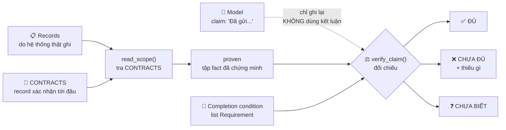
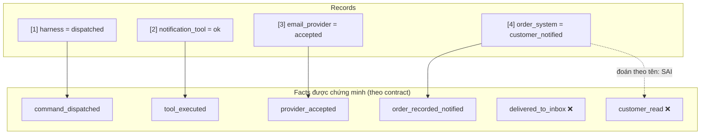
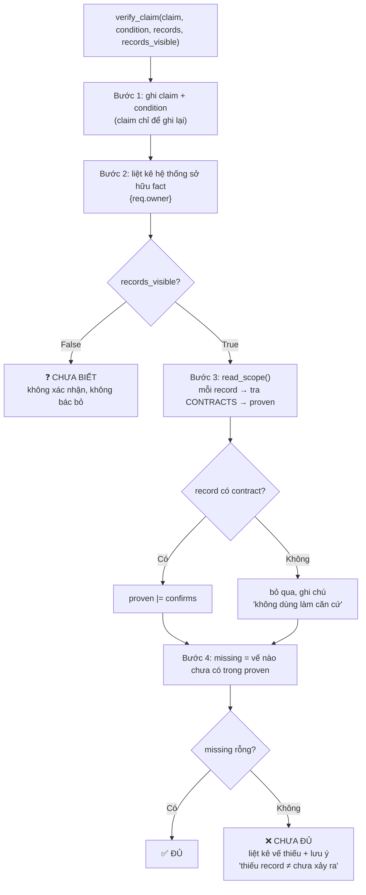
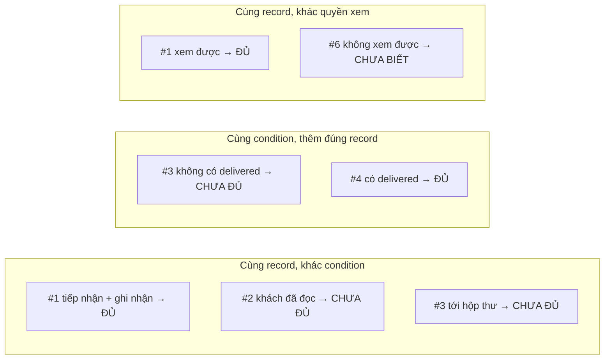

# Bài 10 — Model nói "đã làm", nhưng bằng chứng đâu?

## 1. Ý chính
> **Output của model chỉ là lời kể.** Câu "đã làm" có thể đúng, sai, hoặc đúng một nửa, nhưng nó **không tự tạo ra effect** và **không tự cấp quyền kết luận**.

Đừng hỏi *"model có nói dối không?"* (khó trả lời, không giúp gì). Hãy hỏi:
> **Câu này đang khẳng định điều gì, và hệ thống nào có thể xác nhận điều đó?**

- Model **không tự tay gửi email**. Nó chỉ **yêu cầu** gọi tool.
- **Harness** phát lệnh. **Các hệ thống phía sau** tạo ra effect.
- **Quyền kết luận thuộc về harness**, dựa trên **record đọc từ hệ thống thật**.

## 2. "Đã gửi": gửi tới đâu? (5 nghĩa khác nhau)
1. Lệnh gửi đã được phát đi
2. Công cụ gửi đã chạy xong
3. Nhà cung cấp email/SMS đã nhận thư
4. Hệ thống đơn hàng đã ghi nhận
5. Khách đã thực sự đọc

Có thể 1 và 2 đã xảy ra mà 3 thì chưa. Có thể 4 đã được ghi mà 5 vẫn chưa ai biết. **Câu văn của model không cho biết nó đang nói tới nghĩa nào.**

---

## 3. Định nghĩa thuật ngữ

| Thuật ngữ | Định nghĩa | Ví dụ ORD-001 |
|---|---|---|
| **Claim** | Điều model **khẳng định** trong output. Chỉ là lời kể | "Đã gửi thông báo cho khách" |
| **Record** | Dấu vết do **hệ thống thật** ghi lại | 4 dòng log từ 4 hệ thống |
| **Contract** (của record) | Tài liệu nói record **nghĩa là gì**: ghi khi nào, xác nhận gì, **dừng ở đâu** | "accepted = thư vào hàng đợi, chưa nói đã tới hộp thư" |
| **Dispatch record** | Harness ghi: lệnh **đã rời harness** | `[1] Harness · đã phát lệnh send_customer_notification` |
| **Execution evidence** | **Executor** báo lại đã chạy và kết quả. Dừng ở **ranh giới của executor** | `[2] Notification tool · status = ok` |
| **Provider receipt** | **Nhà cung cấp** tự xác nhận, theo contract **của họ** | `[3] Email provider · accepted` |
| **Domain record** | **Hệ thống nghiệp vụ** tự ghi fact của mình | `[4] Order system · customer_notified` |
| **Executor** | Bên **trực tiếp chạy** lệnh | Notification tool |
| **System of record** | Hệ thống **giữ bản gốc** của một fact | Hệ thống đơn hàng giữ trạng thái đơn |
| **Completion condition** | Định nghĩa **"xong"** của việc này | "Provider tiếp nhận + hệ thống đơn ghi nhận" |
| **Completion evidence** | **Không phải một loại record**, mà là một **QUAN HỆ**: record này, đọc theo contract, có đáp ứng đúng completion condition không | |

Ví dụ con dấu: mỗi record là **một con dấu thật**, nhưng **chỉ xác nhận đúng phần giấy tờ được đóng lên**. Dấu "đã nhận hồ sơ" ≠ "hồ sơ đã được duyệt".

---

## 4. Bốn loại record là bốn PHẠM VI, không phải bậc thang

| Record | Bên ghi | Xác nhận | Dừng ở |
|---|---|---|---|
| **Dispatch** | Harness | Lệnh đã rời harness, đúng tool, đúng đơn | Bên nhận lệnh làm gì |
| **Execution** | Notification tool | Tool **tự báo** đã chạy, ok | Provider làm gì tiếp. "Provider trả lời thành công" vẫn là **lời của tool** |
| **Provider receipt** | Email provider | `accepted` = thư vào **hàng đợi** | Thư đã tới hộp thư chưa |
| **Domain record** | Order system | `customer_notified` được ghi **khi provider tiếp nhận** | Khách đã biết chưa, **dù tên nghe như vậy** |

- Record nào "mạnh" **phụ thuộc vào việc cần xác nhận điều gì**. Hỏi "harness có phát lệnh không?" thì dispatch record trả lời trực tiếp nhất.
- **Đọc định nghĩa, đừng đoán theo tên trạng thái.** `accepted`, `customer_notified`, `delivered`, `read` chỉ mang đúng nghĩa trong tài liệu của bên ghi.

---

## 5. Cùng record, khác condition → khác kết luận

| Completion condition | Kết luận với 4 record | Vì sao |
|---|---|---|
| Provider tiếp nhận **+** hệ thống đơn ghi nhận | ✅ **ĐỦ** | `accepted` và `customer_notified` xác nhận đúng 2 vế |
| Khách **đã đọc** | ❌ **CHƯA ĐỦ** | Không record nào có contract nói "đã đọc" |
| Thư **đã tới hộp thư** | ❌ **CHƯA ĐỦ** | Thiếu record kiểu `delivered` (nếu contract provider định nghĩa vậy) |

> **Evidence không đổi một dòng. Chỉ condition đổi, và kết luận đổi theo.**

Không cần nghi ngờ mọi câu "đã làm". Chỉ cần biết **việc này cần tới đâu**, rồi xem record có đi tới đó không.

---

## 6. Bốn bước kiểm tra một câu "đã làm"

| Bước | Câu hỏi |
|---|---|
| **1. Làm rõ claim** | Khẳng định effect nào? **Completion condition** là gì? (Chưa có condition thì chưa có thước đo) |
| **2. Tìm hệ thống sở hữu** | Ai **thực thi**? Ai **giữ bản gốc** của fact? |
| **3. Đọc phạm vi record** | Theo **contract**, record xác nhận tới đâu, dừng ở đâu? |
| **4. Kết luận đúng phạm vi** | Đủ → chấp nhận. Chưa đủ → **nói thiếu gì**. Không thấy → **"chưa biết"** |

Đây không phải checklist đánh dấu từng ô, mà là **thứ tự câu hỏi** của một người tỉnh táo.

---

## 7. Một record, hai vai trò (lịch họp CAL-042)
- Calendar service **vừa tạo** event (executor) **vừa giữ** event (system of record), nên record vừa là **provider receipt** vừa là **domain record**.
- **Không cần xếp nấc.** Contract và claim quyết định record chứng minh được tới đâu.
- ✅ Chứng minh: **lịch đã được tạo** đúng giờ, đúng người
- ❌ Chưa chứng minh: Lan, Minh, Hà **đã đọc lời mời**, hay **sẽ tham dự**

## 8. Khi không thấy record

| Tình huống | Kết luận đúng | Đừng |
|---|---|---|
| Tìm **không thấy** record | **Chưa đủ căn cứ**: không đủ để nói "đã gửi", cũng không đủ để nói "chưa gửi" | Kết luận "chưa gửi". Record có thể ở hệ thống khác |
| **Không có quyền** xem record | **"Chưa biết"**: chưa xác nhận, chưa bác bỏ | Bịa ra cách kiểm tra mà sản phẩm không có. Để sự im lặng thành câu trả lời |

## 9. Nối với các bài trước

| Bài | Bài 10 đào sâu |
|---|---|
| 04 | "Mình đã kiểm tra" không phải bằng chứng → giờ phân loại **record nào** mới là bằng chứng |
| 06 | Condition + evidence → evidence là **quan hệ**, mỗi record có **phạm vi riêng** |
| 08 | 5 chặng có dấu vết riêng → đọc dấu vết **theo contract** của từng bên |
| 09 | `completed` mang nghĩa theo contract → `accepted`, `customer_notified` **cũng vậy** |

---

## 10. Sơ đồ luồng của bài thực hành

### 10.1. Tổng thể: từ claim tới kết luận

### 10.2. Bốn record của ORD-001: mỗi record chứng minh fact nào

### 10.3. Bên trong `verify_claim()`: 4 bước

### 10.4. Ba cặp so sánh

---

## 11. Từng tình huống: đầu vào → xử lý → kiến thức

| # | Records | Condition | Bước quyết định | Kết luận | Kiến thức |
|---|---|---|---|---|---|
| 1 | 4 record | provider tiếp nhận + đơn ghi nhận | Bước 4: đủ 2 vế | ✅ **ĐỦ** | Mỗi vế có record với contract đúng nghĩa |
| 2 | 4 record | khách đã đọc | Bước 4: thiếu `customer_read` | ❌ **CHƯA ĐỦ** (đoán theo tên: XONG ⚠️) | Evidence là **quan hệ**. Đọc contract, đừng đoán theo tên |
| 3 | 4 record | thư đã tới hộp thư | Bước 3: `accepted` dừng trước hộp thư | ❌ **CHƯA ĐỦ** | Gọi được tên record còn thiếu: `delivered` |
| 4 | 4 + `delivered` | thư đã tới hộp thư | Bước 3: thêm `delivered_to_inbox` | ✅ **ĐỦ** | Đúng record thì kết luận đổi |
| 5 | dispatch + execution | provider tiếp nhận + đơn ghi nhận | Bước 4: thiếu 2 vế | ❌ **CHƯA ĐỦ** | Execution dừng ở ranh giới executor. **Thiếu record ≠ chưa xảy ra** |
| 6 | 4 record (không xem được) | provider tiếp nhận + đơn ghi nhận | Dừng trước bước 3 | ❓ **CHƯA BIẾT** | Không xác nhận, cũng không bác bỏ |
| 7 | 1 record calendar | có event đúng giờ, đúng người | Bước 4: đủ | ✅ **ĐỦ** | **Một record, hai vai trò** |
| 8 | 1 record calendar | mọi người xác nhận dự | Bước 4: thiếu | ❌ **CHƯA ĐỦ** | Tạo lịch ≠ khách mời sẽ dự |

### `proven` sau khi đọc 4 record (dùng cho tình huống 1, 2, 3, 6)
`{command_dispatched, tool_executed, provider_accepted, order_recorded_notified}`
→ **Không có** `customer_read`, **không có** `delivered_to_inbox`.

---

## 12. Hàm nào làm gì, ứng với lý thuyết nào

| Thành phần | Làm gì | Lý thuyết |
|---|---|---|
| `Record` | source (ai ghi), kind (loại), value (trạng thái), time | **Record** do hệ thống thật ghi |
| `CONTRACTS` | `(source, value)` → `confirms` / `meaning` / `stops_at` | **Contract**: record xác nhận tới đâu, dừng ở đâu |
| `Requirement` | fact cần chứng minh + **owner** (hệ thống sở hữu) + label | Một vế của **completion condition** |
| `read_scope()` | Tra contract từng record, gom `proven`. Record không có contract thì bỏ qua | **Bước 3**: đọc phạm vi |
| `verify_claim()` | Chạy đủ 4 bước, trả ĐỦ / CHƯA ĐỦ / CHƯA BIẾT kèm ghi chú | **4 bước** + quyền kết luận thuộc **harness** |
| `records_visible=False` | Dừng sớm → CHƯA BIẾT | Không có quyền xem → "chưa biết" |
| Ghi chú "thiếu record ≠ chưa xảy ra" | Thêm khi CHƯA ĐỦ | Không thấy record ≠ action chưa xảy ra |
| `guess_by_name()` | Thấy "notified" hoặc "accepted" là cho XONG | ❌ **Cách sai**: đoán theo tên |
| `SCENARIOS` | 8 tình huống, mỗi cái đổi **một** yếu tố: condition / records / quyền xem | Cô lập yếu tố để thấy rõ tác động |

### Thiết kế đáng nhớ
- **Claim không bao giờ được dùng để kết luận.** Nó chỉ được ghi vào `notes`.
- **Record không có contract thì không dùng làm căn cứ.** Không tự suy nghĩa từ tên.
- **Condition là dữ liệu** (list `Requirement`). Đổi định nghĩa "xong" mà không phải sửa logic kiểm tra.
- **CHƯA ĐỦ luôn đi kèm "thiếu gì"**, để biết chính xác cần tìm record nào.

---

## 13. Python học thêm

| Cú pháp | Ý nghĩa |
|---|---|
| `{("a", "b"): ...}` | Dict có **khoá là tuple**. Tuple dùng làm khoá được vì không đổi được, list thì không |
| `d.get((x, y))` | Tra bằng tuple. **2 lớp ngoặc**: ngoài của `.get()`, trong tạo tuple |
| `s \|= other` | **Hợp** hai set rồi gán lại (`s = s \| other`) |
| `{"a"} \| {"a", "b"}` | Kết quả `{"a", "b"}`, không trùng |
| `sorted({x.owner for x in xs})` | Set comprehension **bỏ trùng**, `sorted` **sắp xếp**, trả về list |
| `xs[:2]` | Lấy 2 phần tử đầu |
| `xs + [y]` | Tạo **list mới**, list gốc không bị đổi |
| `notes += lines` | Nối list `lines` vào cuối `notes` |
| `"...\"...\"..."` | Dấu nháy kép bên trong chuỗi nháy kép |
| `" + ".join(...)` | Nối chuỗi bằng " + " |
| `title.startswith("2.")` | Chuỗi có bắt đầu bằng "2." không |

---

## 14. Câu hỏi tự kiểm tra
1. Tool trả `ok` kèm *"provider trả lời thành công"*. Đó có phải provider receipt không?
   → **Không.** Đó là **execution evidence**: lời của tool **kể về** provider.
2. `customer_notified` đủ để kết luận "khách đã biết" không?
   → **Không.** Contract nói nó được ghi **khi provider tiếp nhận thư**.
3. Không thấy `notification_status` trong hệ thống đơn. Kết luận "chưa gửi" được không?
   → **Không.** Chỉ là **chưa đủ căn cứ**.
4. Chỉ có khung chat, không xem được record nào. Kết luận gì?
   → **"Chưa biết"**: chưa có gì xác nhận, chưa có gì bác bỏ.