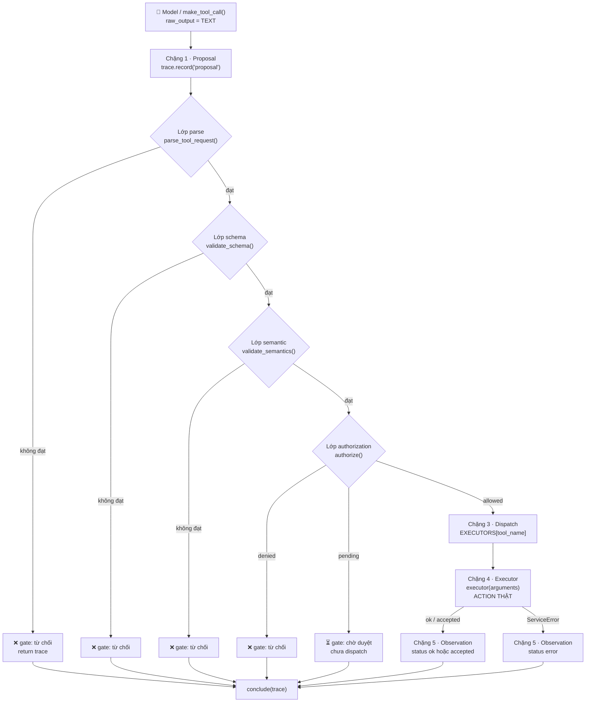
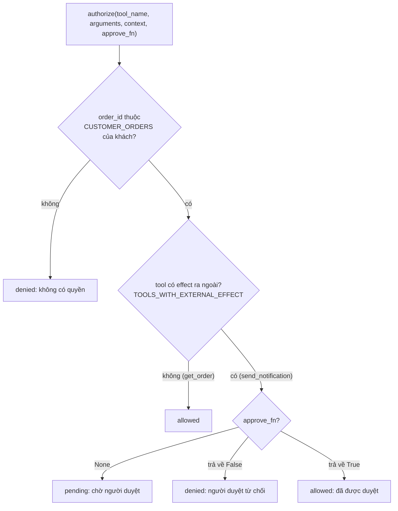
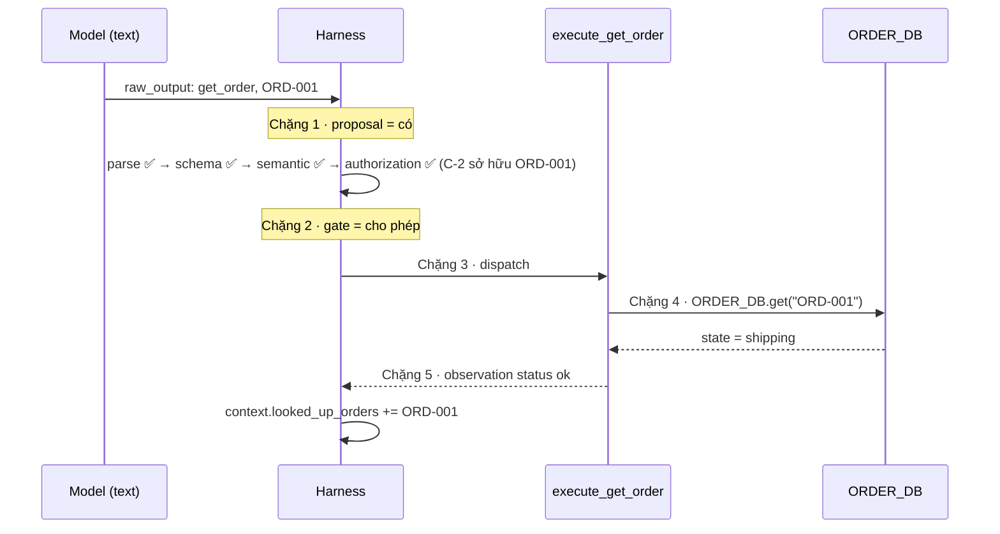

# Bài 08 — Từ tool request tới action thực tế

## 1. Ý chính
> **Tool call không phải là action.** Giữa "model muốn làm" và "việc đã thật sự xảy ra" là **5 chặng**, mỗi chặng có một chủ riêng và để lại một loại dấu vết riêng.

Trên màn hình, `get_order(...)` và `send_customer_notification(...)` trông giống hệt nhau, chỉ là một cái tên và vài arguments. Nhưng **bằng chứng còn thiếu** phía sau mỗi dòng thì khác nhau rất xa.

**Hai câu hỏi trước khi kết luận việc đã xong:**
1. Request này đã đi tới **chặng nào**?
2. Mình đang thực sự có **dấu vết** của những chặng nào?

---

## 2. Định nghĩa các thuật ngữ

| Thuật ngữ | Định nghĩa dễ hiểu | Ví dụ quán ăn |
|---|---|---|
| **Tool call / tool request** | Một đoạn **dữ liệu có cấu trúc** trong output của model, gồm tên tool và arguments. Nó chỉ **mô tả** một action, chưa phải action | Tờ phiếu ghi "một phở bò" |
| **Proposal** | Cách gọi khác của tool request: model **đề xuất** nên làm gì | Phục vụ ghi phiếu |
| **Action** | Việc **thật sự xảy ra**: đọc database, gọi API, gửi tin nhắn | Bếp nấu bát phở |
| **Contract** | Lời công bố của một tool: tên là gì, cần tham số nào, kiểu gì, định dạng ra sao | Thực đơn ghi rõ món có tuỳ chọn gì |
| **Arguments** | Các giá trị model điền vào khi đề xuất gọi tool, ví dụ `{"order_id": "ORD-001"}` | "Phở bò, tái, không hành" |
| **Harness** | Lớp phần mềm bao quanh model: nhận output, kiểm tra, quyết định điều gì được phép xảy ra | Quầy xem phiếu và chuyển vào bếp |
| **Gate** | Cổng kiểm tra của Harness, gồm nhiều lớp. Không qua lớp nào thì **dừng ngay**, không đi tiếp | Quầy xem phiếu có hợp lệ không |
| **Parse** | Lớp 1: output có **đọc được** thành một tool call không? (JSON có hợp lệ, có đủ `name` và `arguments`) | Phiếu có đọc được chữ không |
| **Schema validation** | Lớp 2: arguments có **đúng mẫu** không? (đủ trường, đúng kiểu, đúng định dạng) | Phiếu điền đúng ô, đúng ký hiệu |
| **Semantic validation** | Lớp 3: giá trị có **hợp lý trong ngữ cảnh nghiệp vụ** không? | Món này có khớp bàn đang gọi không |
| **Authorization** | Lớp 4: request có **được phép** chạy không? (người đang chat có quyền với đơn này không) | Khách này có được gọi món này không |
| **Approval** | Một phần của lớp 4: có cần **người duyệt** trước khi chạy không? Thường áp dụng cho tool có effect ra bên ngoài | Món đặc biệt cần quản lý gật đầu |
| **Gate decision** | Kết quả của gate: **cho phép**, **từ chối**, hoặc **chờ duyệt** | Quầy nói: OK / không / đợi quản lý |
| **Dispatch** | Harness **chuyển** request tới đúng executor phụ trách tool | Quầy đưa phiếu vào đúng bếp |
| **Executor** | Phần code **thực sự chạy** tool. Đây là chặng đầu tiên mà action thật có thể xảy ra | Đầu bếp |
| **Service** | Hệ thống bên ngoài mà executor làm việc cùng: database, API quản lý đơn, dịch vụ gửi tin | Kho nguyên liệu, bếp ga |
| **Effect / external effect** | Tác động thật mà action để lại. **External effect** là tác động **ra ngoài hệ thống**: gửi tin, ghi dữ liệu, đổi trạng thái đơn | Bát phở đã tới tay khách |
| **Observation** | Thứ Harness **thật sự nhận lại** sau khi executor chạy: kết quả **hoặc lỗi**. Lỗi cũng là observation có giá trị | Bếp báo "xong" hoặc "hết thịt bò" |
| **Trace / dấu vết** | Bản ghi bằng chứng của **từng chặng**. Thiếu dấu vết của chặng nào thì chưa có bằng chứng về chặng đó | Sổ ghi phiếu, giờ nấu, giờ ra món |
| **Accepted** | Service đã **tiếp nhận** yêu cầu. **Chưa** có nghĩa là việc đã hoàn tất | Shipper nhận hàng ≠ khách đã nhận |
| **Delivered** | Việc đã **tới đích** (tin đã tới điện thoại khách). Thường nằm ngoài tầm nhìn của hệ thống | Khách đã cầm bát phở |

**Giới hạn của ví dụ quán ăn:** ngoài đời, người phục vụ có thể tự đi vào bếp múc phở. **Model thì không.** Model chỉ viết phiếu. Việc xem phiếu, chuyển phiếu và nấu đều thuộc về các thành phần khác.

---

## 3. Năm chặng: ai phụ trách, dấu vết ở đâu

| Chặng | Ai phụ trách | Làm gì | Dấu vết |
|---|---|---|---|
| **1. Proposal** | Model | Sinh tool request trong output | Tool call trong output (thường dễ thấy nhất trên giao diện) |
| **2. Gate** | Harness | parse → schema → semantic → authorization/approval | Gate decision: cho phép / từ chối / chờ duyệt |
| **3. Dispatch** | Harness | Chuyển request tới đúng executor | Bản ghi "đã chuyển tới executor nào" |
| **4. Executor/service** | Executor + service | **Action thật** xảy ra ở đây | Kết quả hoặc lỗi phía service |
| **5. Observation** | Harness nhận | Ghi nhận kết quả để cập nhật state | Kết quả Harness thật sự nhận lại |

- Không phải tool nào cũng cần đủ mọi lớp của gate ở cùng một mức độ. Harness áp dụng những lớp cần thiết cho từng tool.
- `order_not_found` cho biết request đã **đi trọn đường** tới service. Điều này khác hẳn với việc **không nhận được gì**.

## 4. Qua được schema chưa có nghĩa là đúng

Ví dụ: khách gõ nhầm `ORD-001`, trong khi đơn thật của họ là `ORD-010`, và `ORD-001` là đơn có thật của **người khác**. Schema cho qua hoàn toàn (có trường, là chuỗi, đúng định dạng `ORD-###`).

| Schema trả lời được | Schema KHÔNG trả lời được | Lớp nào trả lời |
|---|---|---|
| Có trường `order_id` không | Đơn có tồn tại không | Service (chặng 4) |
| Có phải chuỗi không | Đơn có phải của người đang hỏi không | Semantic / Authorization |
| Có đúng định dạng `ORD-###` không | Người hỏi có quyền xem không | Authorization |
| | Action có tạo ra effect mong muốn không | Observation, và bằng chứng sau đó |

> Coi "qua schema" là đủ để cho chạy thì agent có thể trả **thông tin đơn của người khác** cho người đang chat. Đừng gộp mọi thứ vào một chữ "validate".

## 5. Nguyên tắc đọc dấu vết
> **Thiếu dấu vết của một chặng = chưa có bằng chứng về chặng đó.**
> Không có nghĩa là chặng đó chưa xảy ra, cũng không có nghĩa là đã thành công. Chỉ là **chưa biết**.

## 6. Tool đọc và tool có effect ra ngoài

| | `get_order` (đọc) | `send_customer_notification` (effect ra ngoài) |
|---|---|---|
| Kết quả cần tìm nằm ở đâu | **Ngay trong observation** (`state: shipping`) | **Bên ngoài hệ thống**: trên điện thoại một người thật |
| Observation trả về nói được gì | Đủ để biết kết quả | `accepted` chỉ là service **đã tiếp nhận** yêu cầu |
| Khoảng cách "đã gửi" và "đã xong" | Gần như không có | **Lớn và khó thấy** |

> Tool càng tác động tới con người, hoặc tới những gì nằm ngoài hệ thống, thì khoảng cách giữa "request đã được gửi đi" và "việc đã xong" càng khó thấy.

## 7. Nối với các bài trước

| Bài | Ý liên quan |
|---|---|
| 04 | Model đề xuất, Harness quyết định dispatch. Bài 08 **mở rộng** bước "quyết định" thành 4 lớp gate |
| 05 | Instruction không enforce. Gate là nơi **enforce** bằng code |
| 06 | Cần evidence mới kết luận xong. `accepted` chưa phải evidence của "khách đã nhận" |
| 07 | Observation cập nhật RunState. Ở đây là `context.looked_up_orders` |

---

## 8. Luồng đi trong code

### 8.1. Bức tranh tổng thể của `handle_tool_request()`

Mọi đường **từ chối** hay **chờ duyệt** đều `return trace` **trước** dòng `EXECUTORS[tool_name]`. Vì vậy, khi bị chặn, **không có action nào xảy ra**.

### 8.2. Bên trong lớp authorization

### 8.3. Kịch bản A đi trọn 5 chặng

### 8.4. Tám kịch bản: dừng ở đâu, bài học gì

| # | Kịch bản | Dừng ở | Chặng có dấu vết | Kết luận | Kiến thức áp dụng |
|---|---|---|---|---|---|
| A | Tra đơn hợp lệ | (không dừng) | 1 → 5 | Có kết quả thật `shipping` | Đủ 5 chặng mới có căn cứ |
| B | Gửi tin, chưa ai duyệt | Authorization: **pending** | 1, 2 | Chưa dispatch, chưa có action | Approval cho tool có external effect |
| C | Gửi tin, đã duyệt | (không dừng) | 1 → 5 | Service **accepted**, chưa có bằng chứng khách nhận | accepted ≠ delivered |
| D | Gửi tin về đơn chưa tra | **Semantic** | 1, 2 | Bị chặn | Hợp lý trong ngữ cảnh ≠ đúng mẫu |
| E | JSON bị cụt | **Parse** | 1, 2 | Bị chặn | Chưa đọc được thì chưa biết model muốn gọi gì |
| F | `order_id` là số | **Schema** | 1, 2 | Bị chặn | Schema kiểm tra kiểu dữ liệu |
| G | C-1 gõ nhầm ORD-001 | **Authorization: denied** | 1, 2 | Bị chặn | **Qua schema vẫn có thể sai** |
| H | ORD-020 không có trong DB | (không dừng) | 1 → 5 | Đi trọn đường, nhận lỗi `order_not_found` | **Lỗi cũng là observation** |

**Phụ thuộc thứ tự:** kịch bản C chỉ qua được lớp semantic vì kịch bản A đã thêm `ORD-001` vào `contexts["C-2"].looked_up_orders`. Nếu chạy C trước A, C sẽ bị chặn ở lớp semantic. Đây chính là **state** được mang qua giữa các request (bài 07).

---

## 9. Hàm nào làm gì, ứng với lý thuyết nào

| Thành phần trong code | Làm gì | Lý thuyết |
|---|---|---|
| `TOOL_SCHEMAS` | Mỗi tool khai báo: tên, trường bắt buộc, kiểu, regex định dạng | **Contract** của tool |
| `TOOLS_WITH_EXTERNAL_EFFECT` | Danh sách tool tác động ra ngoài hệ thống | Tool nào cần **approval** |
| `ORDER_DB`, `CUSTOMER_ORDERS` | Dữ liệu đơn hàng, và khách nào sở hữu đơn nào | **Service** + dữ liệu cho **authorization** |
| `ServiceError` | Lỗi phía service (ví dụ `order_not_found`) | Lỗi vẫn thành **observation** |
| `execute_get_order()` | Tra DB, không thấy thì `raise ServiceError` | **Executor** của tool đọc |
| `execute_send_notification()` | Chỉ trả `accepted` + `message_id` | Service **tiếp nhận**, không phải **delivered** |
| `EXECUTORS` | Bảng tên tool → hàm executor | Bảng **dispatch** |
| `RunContext` | Khách là ai, run này đã tra đơn nào | **State** dùng cho semantic và authorization |
| `Trace` | `stages` (5 chặng) + `gate_layers` (từng lớp gate) | **Dấu vết** của từng chặng |
| `parse_tool_request()` | `json.loads`, kiểm tra `name`, `arguments`, tool có tồn tại không | Lớp **parse** |
| `validate_schema()` | Đủ trường, đúng kiểu, `re.fullmatch` định dạng, không có trường thừa | Lớp **schema validation** |
| `validate_semantics()` | Chỉ cho gửi tin về đơn **đã tra thành công** trong run | Lớp **semantic validation** |
| `authorize()` | Kiểm tra quyền sở hữu đơn. Tool có external effect thì cần `approve_fn` | Lớp **authorization / approval** |
| `handle_tool_request()` | Đưa request đi lần lượt qua 5 chặng, ghi trace, dừng ngay khi có lớp không qua | **Pipeline** 5 chặng |
| `print_report()` | In từng chặng. Chặng nào không có thì in "CHƯA CÓ DẤU VẾT" | Thiếu dấu vết = **chưa có bằng chứng** |
| `conclude()` | Kết luận **chỉ dựa trên bằng chứng có trong trace** | Hai câu hỏi trước khi kết luận |
| `make_tool_call()` | Tạo chuỗi JSON giống output của model | Tool call **chỉ là TEXT** |
| `gemini_propose_tool_request()` | Gemini sinh tool request thật | Model **đề xuất**, không thực thi |
| `approve_yes`, `approve_by_human` | Giả lập người duyệt (luôn đồng ý / hỏi bạn y/n) | **Approval** do người quyết định |

### Thiết kế đáng nhớ
- **Mỗi lớp gate là một hàm riêng, trả lời một câu hỏi riêng.** Bị chặn ở đâu thì trace chỉ đúng lớp đó.
- **Dừng sớm:** lớp nào không qua thì `return trace` ngay, nên các chặng sau **không có dấu vết**.
- **Ba trạng thái của gate:** cho phép / từ chối / **chờ duyệt**. "Chờ" khác với "từ chối".
- **`observation["status"]` lấy từ chính kết quả của service** (`result.get("status", "ok")`), nên phân biệt được `ok` và `accepted`.
- **`looked_up_orders` chỉ được thêm khi observation là `ok`.** Đề xuất suông không làm thay đổi state.

---

## 10. Python học thêm trong bài

| Cú pháp | Ý nghĩa |
|---|---|
| `re.fullmatch(pattern, value)` | Khớp **toàn bộ** chuỗi (khác `re.search` chỉ cần khớp một đoạn) |
| `r"ORD-\d{3}"` | `\d{3}` = **đúng 3** chữ số |
| `r".{1,200}"` + `re.DOTALL` | Từ 1 đến 200 ký tự bất kỳ. `DOTALL` cho `.` khớp cả ký tự xuống dòng |
| `rule["type"].__name__` | Lấy tên của kiểu dữ liệu, ví dụ `str` thành `"str"` |
| `type(value).__name__` | Tên kiểu của giá trị thực tế, ví dụ `"int"` |
| `f"{value!r}"` | In theo dạng `repr`: chuỗi có dấu nháy, nhìn rõ kiểu dữ liệu |
| `set(a) - set(b)` | Hiệu hai set: phần tử có trong a nhưng không có trong b (tìm trường thừa) |
| `sorted(extra)` | Sắp xếp để thông báo lỗi ổn định, dễ đọc |
| `class ServiceError(Exception): pass` | Tự tạo **loại lỗi riêng** |
| `raise ServiceError("...")` | Ném lỗi |
| `except ServiceError as error:` | Bắt đúng loại lỗi đó, lấy nội dung bằng `str(error)` |
| `executor.__name__` | Tên của hàm, ví dụ `"execute_get_order"` |
| `return None, "lý do"` / `return True, "..."` | Trả về (kết quả, giải thích): kiểu hàm kiểm tra phổ biến |
| `"đạt" if ok else "KHÔNG đạt"` | If-else một dòng |
| `sys.argv[1] if len(sys.argv) > 1 else "fake"` | Đọc tham số dòng lệnh, có giá trị mặc định |
| `lambda tool_name, arguments: True` | Hàm ẩn danh làm "người duyệt" |
| `input(...).strip().lower() == "y"` | Hỏi người dùng, chuẩn hoá câu trả lời rồi so sánh |
| `trace.stages.get("gate", ("", ""))[0]` | `.get` với giá trị mặc định là một tuple, rồi lấy phần tử đầu |
| `isinstance(data.get("arguments"), dict)` | Kiểm tra kiểu một cách an toàn kể cả khi thiếu khoá |

---

## 11. Có thể làm tiếp
- **Semantic cho `get_order`:** kiểm tra `order_id` có khớp với mã đơn khách nhắc tới trong tin nhắn không (bắt kiểu model "bịa" mã đơn).
- **Trạng thái `delivered`:** thêm một service giả trả về `delivered` sau khi có event, để thấy cần thêm bằng chứng gì mới kết luận được "khách đã nhận tin" (nối bài 06).
- **Approval một lần cho một action:** lưu quyết định duyệt theo từng `message_id`, không dùng chung một `approve_fn` cho mọi request.